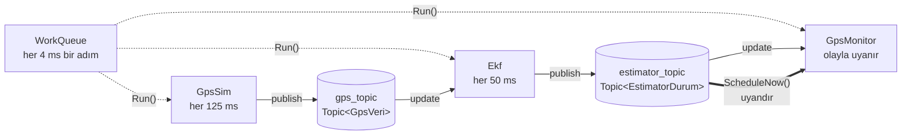
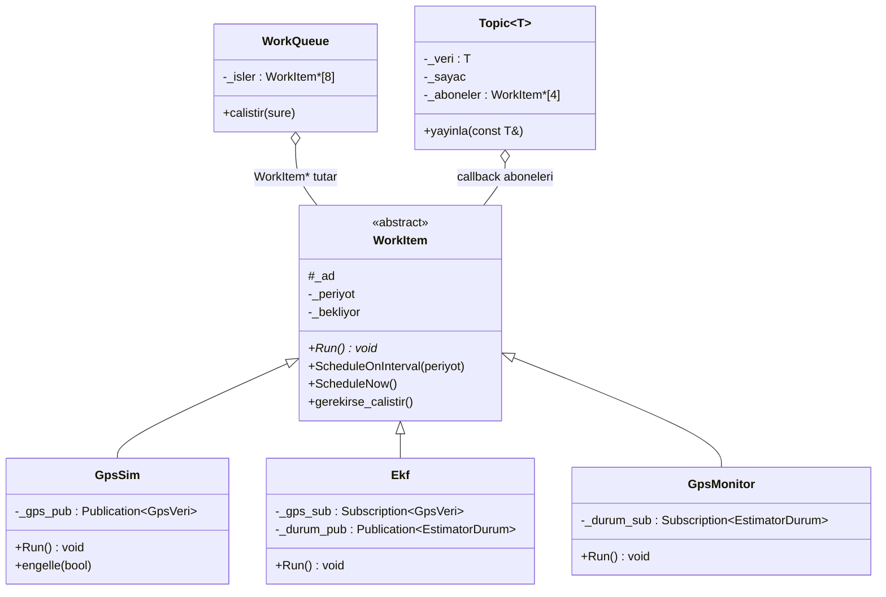
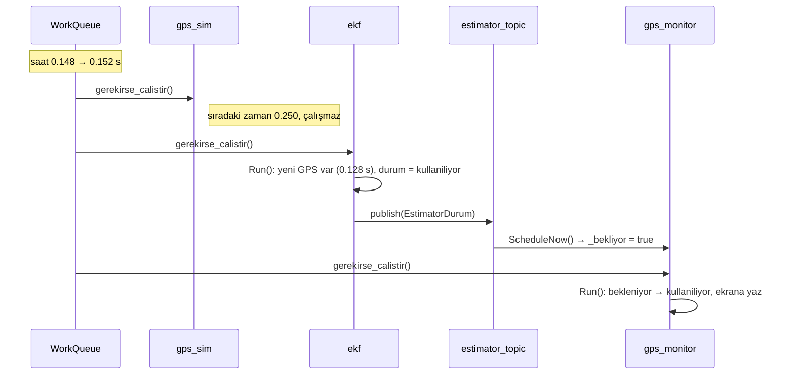

# 9. bitirme: mini PX4

İlk 8 derste öğrendiklerimi tek bir programda birleştirdim: PX4'ün çekirdek fikrinin düz C++ ile yazılmış oyuncak hali. İçinde bir work queue, `virtual Run()` ile çalışan modüller, template'li topic'ler, periyodik çalışan ve bir topic'e veri gelince uyanan modüller var. Bunlarla PX4 çalışmamdaki GPS kaybı deneyini küçük ölçekte yeniden yaptım.

Bu derste C sürümü yok; her parçanın C karşılığı ilgili derste. Kod `mini_px4.cpp` dosyasında; her C++ satırının ne yaptığı yanında yorum olarak yazılı.

## Büyük resim

Üç modül, bir work queue ve iki topic var. Modüller birbirini hiç çağırmıyor; sadece topic'lere yazıp okuyorlar. Work queue da hangisinin ne olduğunu bilmeden her birinin `Run()`'ını çağırıyor.



| Modül | Ne zaman çalışıyor | Ne yapıyor | PX4'teki karşılığı |
|---|---|---|---|
| **gps_sim** | her 125 ms | `gps_topic`'e konum yayınlıyor; "engelli" iken yayını kesiyor | `sensor_gps_sim`, `failure gps off` |
| **ekf** | her 50 ms | yeni GPS varsa zamanını alıyor; 1 s'dir GPS yoksa "kayıp" diyor; sonucu `estimator_topic`'e yazıyor | EKF2'nin `cs_gnss_pos` bayrağı |
| **gps_monitor** | `estimator_topic`'e her yayında (olayla) | GPS durumu değiştiyse ekrana yazıyor | callback'li bir uORB aboneliği |
| **work queue** | sürekli, 4 ms adımlarla (250 Hz) | saati ilerletip her modüle "zamanın geldiyse ya da uyandırıldıysan çalış" diyor | `wq:` thread'leri |

`main` 2 saniye normal çalıştırıyor, sonra GPS'i kesip 3 saniye, sonra GPS'i geri açıp 1 saniye daha çalıştırıyor. En sonda work queue'nun durumunu yazdırıyor.

## Sınıflar arası ilişki



- **Kalıtım (5. ders):** `GpsSim`, `Ekf`, `GpsMonitor` birer `WorkItem`. Zamanlama kodunu (`ScheduleOnInterval`, `ScheduleNow`, `gerekirse_calistir`) yeniden yazmıyorlar, devralıyorlar.
- **virtual (6. ders):** `Run()` WorkItem'da `= 0`; her modül kendi `Run()`'ını yazmak zorunda. Work queue sadece `WorkItem*` tutuyor ama çağrı gerçek modüle gidiyor.
- **template (7. ders):** `Topic<T>`, `Publication<T>`, `Subscription<T>` bir kez yazıldı; derleyici `GpsVeri` ve `EstimatorDurum` için ayrı ayrı üretti. Yanlış tipi yayınlamak derlenmiyor.

## Kodu parça parça okumak

Tamamı aşağıda *Kodun tamamı* bölümünde. Önce altı parçaya bakmak okumayı kolaylaştırıyor.

**1. Zaman (8. ders):** `125_ms` yazınca derleyici `operator ""_ms`'i çalıştırıp yerine 125000 koyuyor.

```cpp
using zaman_us = uint64_t;                                          // typedef uint64_t zaman_us;
constexpr zaman_us operator ""_ms(unsigned long long ms) { return ms * 1000; }
```

**2. WorkItem (1, 2, 5, 6. ders):** Her modülün temeli. Zamanı geldiyse veya uyandırıldıysa `Run()`'ı çağırıyor.

```cpp
class WorkItem {
public:
    WorkItem(const char *ad) : _ad(ad) {}     // constructor + initializer list
    virtual void Run() = 0;                   // her modül kendi Run'ını yazmak zorunda
    void ScheduleNow() { _bekliyor = true; }  // "beni bir sonraki adımda çalıştır"
    // ...
};
```

**3. Topic / Publication / Subscription (3, 7. ders):** Yayıncı ve okuyucu birbirini tanımıyor; ikisi de aynı topic'e referansla bağlı. Okuyucu, topic'in sayacı kendi okuduğundan farklıysa yeni veri olduğunu anlıyor.

```cpp
template<typename T>
class Topic {
    void yayinla(const T &v) { _veri = v; _sayac++; /* callback'li aboneleri ScheduleNow() ile uyandır */ }
};
bool update(T *hedef) { if (!updated()) return false; *hedef = _topic.veri(); _okunan = _topic.sayac(); return true; }
```

**4. WorkQueue:** Saati 4 ms ilerletip sıradaki her işe bakıyor.

```cpp
while (simdi < bitis) {
    simdi += 4_ms;
    for (int i = 0; i < _sayi; i++) { _isler[i]->gerekirse_calistir(); }
}
```

**5. Modüller:** Constructor'da kendini zamanlıyor, `Run()`'da işini yapıyor.

```cpp
class Ekf : public WorkItem {
    Ekf() : WorkItem("ekf") { ScheduleOnInterval(50_ms); }
    void Run() override { /* yeni GPS varsa zamanı al, 1 s aşıldıysa Kayip, durumu yayınla */ }
    static constexpr zaman_us GPS_ZAMAN_ASIMI = 1_s;
};
Subscription<EstimatorDurum> _durum_sub{estimator_topic, this};   // GpsMonitor: "yayın gelince beni uyandır"
```

**6. main:** Nesneleri oluşturuyor (constructor'lar çalışıyor), work queue'ya ekliyor, senaryoyu oynatıyor. `return 0` ile destructor'lar çalışıyor.

## Kodun tamamı

Dosya: `mini_px4.cpp`

<details>
<summary>Açmak için tıkla (yorumlu, 355 satır)</summary>

```cpp
// 9. ders, bitirme: PX4'ün çekirdek fikrinin oyuncak hali.
// Work queue, virtual Run(), template'li topic'ler, periyodik ve olayla tetiklenen modüller.
#include <cstdio>     // C'deki <stdio.h>'nin C++ adı: printf
#include <cstdint>    // C'deki <stdint.h>: uint64_t, int32_t ...

namespace mini        // namespace: isimleri bir "soyadı" altında toplar; dışarıdan mini::simdi diye erişilir
{                     // C'de bunun yerine her isme mini_ prefix'i yazardık

// ---------------- Zaman (8. ders: constexpr, süre yazımı) ----------------
using zaman_us = uint64_t;   // using = typedef'in C++ yazımı: typedef uint64_t zaman_us;
zaman_us simdi = 0;          // simülasyon saati, mikrosaniye (namespace içinde global değişken)

namespace time_literals      // süre literallerini ayrı bir namespace'e koyuyoruz; isteyen "using" ile açar
{
// operator ""_ms → kullanıcı tanımlı literal: kodda 125_ms yazınca bu fonksiyon çağrılır ve 125000 döner
// constexpr → sonuç derleme sırasında hesaplanır; programa doğrudan 125000 sayısı yazılır, çalışırken 0 tick
constexpr zaman_us operator ""_ms(unsigned long long ms) { return ms * 1000; }
constexpr zaman_us operator ""_s(unsigned long long s)   { return s * 1000000; }
} // namespace time_literals

using namespace time_literals;   // bu namespace'teki isimleri burada önek yazmadan kullan (4_ms gibi)

// ---------------- WorkItem (5. ders: kalıtım, 6. ders: virtual) ----------------
class WorkItem                   // class: veri + o veri üzerinde çalışan fonksiyonlar tek pakette (C'de struct + fonksiyonlar)
{
public:                          // public: dışarıdan erişilebilen kısım (API)
    // constructor: nesne oluşurken otomatik çalışır. ": _ad(ad)" = initializer list, üyeyi gövdeden önce ilk değerle kurar
    WorkItem(const char *ad) : _ad(ad) {}

    // virtual destructor: türeyen nesne WorkItem* üzerinden silinirse türeyenin destructor'ı da çalışsın diye
    virtual ~WorkItem() {}

    // pure virtual (= 0): WorkItem kendi Run'ını yazmıyor; her türeyen class yazmak ZORUNDA.
    // virtual → çağrı çalışma anında nesnenin gerçek tipine gider (C'deki struct içindeki fonksiyon pointer'ı gibi)
    virtual void Run() = 0;

    void ScheduleNow() { _bekliyor = true; }   // class içinde tanımlanan üye fonksiyon; _bekliyor bu nesnenin alanı

    void ScheduleOnInterval(zaman_us periyot)
    {
        _periyot = periyot;
        _sonraki = simdi + periyot;
    }

    // Work queue her adımda çağırıyor: zamanı geldiyse ya da tetiklendiyse Run()
    void gerekirse_calistir()
    {
        const bool zamani_geldi = (_periyot != 0 && simdi >= _sonraki);   // bool: C++'ta yerleşik tip (C'de stdbool.h)

        if (zamani_geldi || _bekliyor) {
            if (zamani_geldi) {
                _sonraki += _periyot;
            }
            _bekliyor = false;
            _calisma_sayisi++;
            Run();               // virtual çağrı: GpsSim ise GpsSim::Run, Ekf ise Ekf::Run çalışır
        }
    }

    // sondaki const: bu fonksiyon nesnenin alanlarını değiştirmez (derleyici kontrol eder)
    void durum_yazdir() const
    {
        if (_periyot != 0) {
            printf("  %-12s her %3u ms   %4u calisma\n", _ad, (unsigned)(_periyot / 1000), (unsigned)_calisma_sayisi);
        } else {
            printf("  %-12s olay ile     %4u calisma\n", _ad, (unsigned)_calisma_sayisi);
        }
    }

protected:                       // protected: dışarıya kapalı, ama türeyen class'lar (GpsSim, Ekf ...) erişebilir
    const char *_ad;

private:                         // private: yalnız bu class'ın kendi fonksiyonları erişebilir
    // {0} = üye başlangıç değeri (default member initializer): constructor yazmasan da bu değerle başlar
    zaman_us _periyot{0};
    zaman_us _sonraki{0};
    bool     _bekliyor{false};
    uint32_t _calisma_sayisi{0};
};

// ---------------- Topic, Publication, Subscription (7. ders: template, 3. ders: referans) ----------------
// template<typename T>: T yerine hangi tip verilirse (GpsVeri, EstimatorDurum ...) derleyici o tip için
// class'ın bir kopyasını üretir. C'de her mesaj tipi için ayrı struct + fonksiyon yazmak ya da void* kullanmak gerekirdi.
template<typename T>
class Topic
{
public:
    // const T &v: referans ile alıyor (kopya yok, pointer gibi ama NULL olamaz); const → fonksiyon v'yi değiştiremez
    void yayinla(const T &v)
    {
        _veri = v;               // struct ataması: T'nin tüm alanları kopyalanır
        _sayac++;
        for (int i = 0; i < _abone_sayisi; i++) {
            _aboneler[i]->ScheduleNow();      // callback'li aboneleri uyandır (-> : pointer üzerinden üye çağrısı, C'deki gibi)
        }
    }

    void callback_ekle(WorkItem *w)
    {
        if (_abone_sayisi < 4) {
            _aboneler[_abone_sayisi++] = w;
        }
    }

    uint32_t sayac() const { return _sayac; }
    const T &veri() const { return _veri; }   // const referans döndürür: okuyan kopya almaz, değiştiremez de

private:
    T         _veri{};           // {} = sıfırla başlat (C'deki = {0} gibi)
    uint32_t  _sayac{0};
    WorkItem *_aboneler[4] {};   // 4 elemanlı pointer dizisi, hepsi nullptr ile başlar
    int       _abone_sayisi{0};
};

template<typename T>
class Publication
{
public:
    // referans üye (_topic) mutlaka initializer list'te bağlanır; sonradan başka topic'e çevrilemez
    Publication(Topic<T> &topic) : _topic(topic) {}

    void publish(const T &v) { _topic.yayinla(v); }   // referans üzerinden çağrı: '.' ile (pointer olsaydı '->')

private:
    Topic<T> &_topic;            // referans: başka bir nesnenin takma adı; kopya değil, aynı Topic
};

template<typename T>
class Subscription
{
public:
    // callback verilirse, topic'e her yayında o modül uyandırılır
    // "= nullptr": default parametre; çağıran ikinci argümanı vermezse nullptr olur
    // nullptr: C++'ın tip güvenli NULL'u (8. ders)
    Subscription(Topic<T> &topic, WorkItem *callback = nullptr) : _topic(topic)
    {
        if (callback != nullptr) {
            _topic.callback_ekle(callback);
        }
    }

    bool updated() const { return _okunan != _topic.sayac(); }   // son okuduğumdan beri yeni yayın var mı?

    bool update(T *hedef)        // yeni veri varsa hedef'e kopyalar ve true döner
    {
        if (!updated()) {
            return false;
        }
        *hedef = _topic.veri();
        _okunan = _topic.sayac();
        return true;
    }

private:
    Topic<T> &_topic;
    uint32_t  _okunan{0};
};

// ---------------- Work queue ----------------
class WorkQueue
{
public:
    // WorkItem* tutuyor ama içine GpsSim*, Ekf* ... konabiliyor: türeyen class pointer'ı temel class pointer'ına otomatik çevrilir
    void ekle(WorkItem *w)
    {
        if (_sayi < 8) {
            _isler[_sayi++] = w;
        }
    }

    // Saati 4 ms'lik adımlarla (250 Hz) ilerletip her adımda işlere bakıyor
    void calistir(zaman_us sure)
    {
        const zaman_us bitis = simdi + sure;

        while (simdi < bitis) {
            simdi += 4_ms;       // 4_ms → derleme sırasında 4000'e dönüşür
            for (int i = 0; i < _sayi; i++) {
                _isler[i]->gerekirse_calistir();
            }
        }
    }

    void status() const
    {
        for (int i = 0; i < _sayi; i++) {
            _isler[i]->durum_yazdir();
        }
    }

private:
    WorkItem *_isler[8] {};
    int       _sayi{0};
};

// ---------------- Mesajlar (8. ders: enum class) ----------------
struct GpsVeri {                 // C++'ta struct = varsayılanı public olan class; "struct GpsVeri" yazmadan GpsVeri kullanılır
    zaman_us zaman;
    int32_t  lat;
    int32_t  lon;
    uint8_t  uydu;
};

// enum class: değerler GpsDurumu:: önekiyle yazılır, int'e kendiliğinden çevrilmez, başka enum'la karıştırılamaz.
// ": uint8_t" → altta 1 byte tutulur (C enum'u genelde 4 byte)
enum class GpsDurumu : uint8_t { Bekleniyor, Kullaniliyor, Kayip };

struct EstimatorDurum {
    zaman_us  zaman;
    GpsDurumu gps;
};

// template'in kullanıldığı yer: derleyici burada Topic<GpsVeri> ve Topic<EstimatorDurum> class'larını üretir
Topic<GpsVeri>        gps_topic;
Topic<EstimatorDurum> estimator_topic;

} // namespace mini

// ---------------- Modüller (1. ders: class, 2. ders: constructor/destructor) ----------------
using namespace mini;                    // mini:: önekini yazmadan kullan
using namespace mini::time_literals;     // 125_ms, 1_s yazımları için

// GPS simülatörü: her 125 ms'de bir konum yayınlıyor. Engelliyken yayınlamıyor.
class GpsSim : public WorkItem           // ": public WorkItem" → kalıtım: GpsSim bir WorkItem'dır, onun üyelerini devralır
{
public:
    // önce temel class'ın constructor'ı çalışır (WorkItem("gps_sim")), sonra bu gövde
    GpsSim() : WorkItem("gps_sim")
    {
        ScheduleOnInterval(125_ms);      // devralınan fonksiyon, doğrudan çağrılabiliyor
    }

    // override: "temel class'taki virtual fonksiyonu eziyorum" — isim/imza yanlışsa derleyici hata verir
    ~GpsSim() override
    {
        printf("  gps_sim kapandi\n");   // destructor: nesnenin ömrü bitince (main'den çıkarken) otomatik çalışır
    }

    void engelle(bool engelli) { _engelli = engelli; }

    void Run() override                  // WorkItem::Run'ın GpsSim hali; work queue zamanı gelince bunu çağırır
    {
        if (_engelli) {
            return;
        }

        GpsVeri v{};                     // {} → tüm alanlar sıfırla başlar
        v.zaman = simdi;
        // static_cast: kontrollü tip çevirme, C'deki (int32_t)(...) ile aynı komut; sadece derlemede kontrol ekler
        v.lat   = 473977420 + static_cast<int32_t>(simdi / 1000000);   // saniyede bir biraz kaysın
        v.lon   = 85455940;
        v.uydu  = 12;
        _gps_pub.publish(v);
    }

private:
    Publication<GpsVeri> _gps_pub{gps_topic};   // üye nesne, {gps_topic} ile constructor'ına topic veriliyor
    bool _engelli{false};
};

// Tahminci: her 50 ms'de GPS'e bakıyor, 1 saniyedir yeni GPS yoksa "kayıp" diyor.
class Ekf : public WorkItem
{
public:
    Ekf() : WorkItem("ekf")
    {
        ScheduleOnInterval(50_ms);
    }

    void Run() override
    {
        GpsVeri gps;
        if (_gps_sub.update(&gps)) {     // yeni GPS geldiyse gps'e kopyalanır
            _son_gps_zamani = gps.zaman;
        }

        GpsDurumu durum = GpsDurumu::Bekleniyor;   // enum class değeri: önekiyle yazılmak zorunda
        if (_son_gps_zamani != 0) {
            durum = (simdi - _son_gps_zamani > GPS_ZAMAN_ASIMI) ? GpsDurumu::Kayip : GpsDurumu::Kullaniliyor;
        }

        // EstimatorDurum{simdi, durum}: geçici struct'ı alan sırasıyla doldurup doğrudan gönderiyor
        _durum_pub.publish(EstimatorDurum{simdi, durum});
    }

private:
    // static: tüm Ekf nesneleri için tek kopya; constexpr: derleme sırasında 1000000 olur (#define'ın tip güvenli hali)
    static constexpr zaman_us GPS_ZAMAN_ASIMI = 1_s;    // PX4 EKF2'de bu süre 7 saniye

    Subscription<GpsVeri>       _gps_sub{gps_topic};          // callback yok → Ekf GPS gelince uyanmaz, kendi periyodunda bakar
    Publication<EstimatorDurum> _durum_pub{estimator_topic};
    zaman_us                    _son_gps_zamani{0};
};

// GPS monitörü: periyodik değil; estimator her yayın yaptığında uyanıyor, durum değişince yazıyor.
class GpsMonitor : public WorkItem
{
public:
    GpsMonitor() : WorkItem("gps_monitor") {}   // ScheduleOnInterval çağırmıyor → periyodik değil

    void Run() override
    {
        EstimatorDurum d;
        if (_durum_sub.update(&d) && d.gps != _onceki) {   // enum class karşılaştırması: aynı tipler arasında serbest
            printf("[%6.3f s] gps_monitor: %s -> %s\n", d.zaman / 1e6, ad(_onceki), ad(d.gps));
            _onceki = d.gps;
        }
    }

private:
    // static üye fonksiyon: nesneye (this'e) ihtiyaç duymaz; C'deki dosya içi static fonksiyon gibi
    static const char *ad(GpsDurumu g)
    {
        switch (g) {
        case GpsDurumu::Bekleniyor:   return "bekleniyor";
        case GpsDurumu::Kullaniliyor: return "kullaniliyor";
        case GpsDurumu::Kayip:        return "KAYIP";
        }
        return "?";
    }

    // this: bu nesnenin kendi adresi (GpsMonitor*). Topic'e "yayın gelince beni uyandır" diye kendini veriyor
    Subscription<EstimatorDurum> _durum_sub{estimator_topic, this};   // callback: this
    GpsDurumu _onceki{GpsDurumu::Bekleniyor};
};

int main()
{
    // nesneler stack'te oluşuyor; burada constructor'lar çalışır, main bitince destructor'lar ters sırayla çalışır
    GpsSim     gps;
    Ekf        ekf;
    GpsMonitor monitor;

    WorkQueue wq;
    wq.ekle(&gps);               // &gps: GpsSim* → WorkItem* olarak saklanır (kalıtım sayesinde)
    wq.ekle(&ekf);
    wq.ekle(&monitor);

    printf("[%6.3f s] basladi\n", simdi / 1e6);
    wq.calistir(2_s);

    printf("[%6.3f s] GPS kesiliyor\n", simdi / 1e6);
    gps.engelle(true);
    wq.calistir(3_s);

    printf("[%6.3f s] GPS geri aciliyor\n", simdi / 1e6);
    gps.engelle(false);
    wq.calistir(1_s);

    printf("[%6.3f s] work queue durumu:\n", simdi / 1e6);
    wq.status();

    printf("program bitiyor:\n");
    return 0;                    // buradan sonra monitor, ekf, gps destructor'ları çalışır → "gps_sim kapandi"
}
```

</details>

## Çıktı

`./calistir.sh 09-bitirme/mini_px4.cpp`:

```
[ 0.000 s] basladi
[ 0.152 s] gps_monitor: bekleniyor -> kullaniliyor
[ 2.000 s] GPS kesiliyor
[ 3.052 s] gps_monitor: kullaniliyor -> KAYIP
[ 5.000 s] GPS geri aciliyor
[ 5.152 s] gps_monitor: KAYIP -> kullaniliyor
[ 6.000 s] work queue durumu:
  gps_sim      her 125 ms     48 calisma
  ekf          her  50 ms    120 calisma
  gps_monitor  olay ile      120 calisma
program bitiyor:
  gps_sim kapandi
```

| Çıktı | Ne oldu |
|---|---|
| `[0.152 s] bekleniyor -> kullaniliyor` | İlk GPS 0.128 s'de yayınlandı; EKF bir sonraki çalışmasında (0.152 s) gördü ve durumu yayınladı; gps_monitor aynı adımda uyanıp değişikliği yazdı |
| `[2.000 s] GPS kesiliyor` | `gps.engelle(true)`. Son GPS yayını tam 2.000 s'de yapılmıştı |
| `[3.052 s] kullaniliyor -> KAYIP` | EKF 3.000 s'de çalıştığında son GPS'in üzerinden tam 1.000 s geçmişti, sınırı aşmamıştı. 3.052 s'deki çalışmasında 1.052 s geçmişti → kayıp |
| `[5.000 s] GPS geri aciliyor` | `gps.engelle(false)` |
| `[5.152 s] KAYIP -> kullaniliyor` | GPS 5.128 s'de yeniden yayınladı, EKF 5.152 s'de gördü |
| `gps_sim her 125 ms 48 calisma` | 6 saniye / 125 ms = 48. GPS kesikken de Run() çağrıldı ama yayın yapmadı |
| `ekf her 50 ms 120 calisma` | 6 saniye / 50 ms = 120 |
| `gps_monitor olay ile 120 calisma` | EKF'nin her yayını onu bir kez uyandırdı: 120. Ama sadece 3 kez yazdı, çünkü sadece 3 kez durum değişti |
| `gps_sim kapandi` | `main` biterken GpsSim'in destructor'ı çalıştı |

Aynı çalışmanın zaman çizgisi (1 karakter = 0,1 s; █ GPS yayını var, ░ yok, b = bekleniyor, ▲ gps_monitor ekrana yazdı):

```
zaman (s)    0                   2          3.05               5         6
             |                   |          |                  |         |
GPS yayını   ░░███████████████████░░░░░░░░░░░░░░░░░░░░░░░░░░░░░░░█████████
EKF durumu   b kullaniliyor                 KAYIP                kullaniliyor
                                 └── 1 s ──┘
gps_monitor    ▲                            ▲                    ▲
```

PX4 çalışmamdaki gerçek deneyde EKF2'nin GPS'i bırakması 7.9 saniye sürmüştü; orada zaman aşımı 7 saniye. Burada 1 saniye koydum, akış aynı.

## Hangi parça hangi dersten?

| Kodda | Ne yapıyor | Ders |
|---|---|---|
| `class GpsSim`, `class Ekf`, `_ad`, `_engelli` gibi alanlar, `public`/`private` | Her modül veriyi ve fonksiyonlarını bir arada tutuyor | 1. class |
| `GpsSim() : WorkItem("gps_sim") { ScheduleOnInterval(125_ms); }`, `~GpsSim()` | Modül oluşurken kendini zamanlıyor; program biterken destructor çalışıyor | 2. constructor/destructor |
| `Publication(Topic<T> &topic) : _topic(topic)`, `publish(const T &v)`, `update(T *hedef)` | Topic'e referansla bağlanmak; veriyi kopyasız vermek; okurken pointer'la hedefe yazmak | 3. referans ve const |
| `namespace mini`, `namespace time_literals`, `using namespace` | Altyapı isimleri bir namespace'te, süre yazımları ayrı küçük bir namespace'te | 4. namespace |
| `class GpsSim : public WorkItem` | Her modül WorkItem'ın zamanlama işlerini miras alıyor (`ScheduleOnInterval`, `ScheduleNow`) | 5. kalıtım |
| `virtual void Run() = 0;`, `void Run() override`, `_isler[i]->gerekirse_calistir()` içindeki `Run()` | Work queue modüllerin türünü bilmeden her birinin kendi Run'ını çalıştırıyor | 6. virtual |
| `Topic<T>`, `Publication<T>`, `Subscription<T>` | Her mesaj tipi için ayrı, tip güvenli topic ve yayıncı/okuyucu | 7. template |
| `enum class GpsDurumu : uint8_t`, `constexpr`, `125_ms`, `1_s`, `static_cast`, `nullptr` | Durum değerleri, süre sabitleri, tip çevirme, "callback yok" varsayılanı | 8. küçük yardımcılar |

## Bir adımda ne oluyor?

0.152 s'deki adım, ilk "kullaniliyor" mesajının yazıldığı an:



Adım adım:

1. Work queue saati 0.148'den 0.152'ye ilerletiyor ve sırayla üç modülün `gerekirse_calistir()` fonksiyonunu çağırıyor.
2. **gps_sim**: bir sonraki çalışma zamanı 0.250, henüz gelmedi; hiçbir şey yapmıyor.
3. **ekf**: çalışma zamanı 0.150 idi, geçti. `Run()` çağrılıyor (virtual, 6. ders).
   - `_gps_sub.update(&gps)`: topic'in sayacı (1) okuduğum sayaçtan (0) farklı → yeni veri var. GPS verisi `gps`'e kopyalanıyor, son GPS zamanı 0.128 oluyor.
   - 0.152 − 0.128 = 0.024 s < 1 s → durum "kullaniliyor".
   - `_durum_pub.publish(...)`: `estimator_topic`'e yazılıyor. Topic, callback listesindeki **gps_monitor**'un `ScheduleNow()`'ını çağırıyor; gps_monitor'un "bekliyor" bayrağı true oluyor.
4. **gps_monitor**: bekliyor bayrağı true → aynı adımda `Run()` çağrılıyor. `update(&d)` yeni durumu okuyor; önceki "bekleniyor"du, şimdi "kullaniliyor" → ekrana yazıyor.

gps_monitor kuyrukta EKF'den sonra olduğu için EKF'nin yayınını aynı adımda gördü. Önce olsaydı, bir sonraki adımda (4 ms sonra) görecekti.

## Neden 0.150 değil de 0.152?

EKF her 50 ms'de çalışacak şekilde zamanlandı, ama ilk çalışması 0.152 s'de oldu. Sebebi, work queue'nun saati 4 ms'lik adımlarla ilerletmesi: 0.148'de zamanı gelmemişti, bir sonraki adım 0.152. Yani her modül, zamanı geldikten sonraki ilk adımda çalışıyor; 0–4 ms arası bir gecikme oluyor.

Gerçek sistemlerde de buna benzer bir gecikme var. PX4'te `work_queue status` çıktısında EKF2'nin `249.5 Hz` (tam 250 değil) ve aralığının `4009 us` (tam 4000 değil) çıkması bu türden küçük zamanlama sapmalarını gösteriyordu.

## PX4'teki karşılıkları

| Mini PX4'te | PX4'te | Dosya |
|---|---|---|
| `WorkItem`, `virtual void Run() = 0;` | `WorkItem`, `virtual void Run() = 0;` | `px4_work_queue/WorkItem.hpp` |
| `ScheduleOnInterval(125_ms)` | `ScheduleOnInterval(125_ms)` | `px4_work_queue/ScheduledWorkItem.hpp` |
| `WorkQueue::calistir` içindeki `gerekirse_calistir()` → `Run()` | `WorkQueue::Run()` içindeki `work->Run();` | `px4_work_queue/WorkQueue.cpp` |
| `Topic<T>` | uORB topic'i (`ORB_ID(sensor_gps)` gibi) | `uORB/` |
| `Publication<T>::publish(const T &)` | `uORB::Publication<T>::publish(const T &)` | `uORB/Publication.hpp` |
| `Subscription<T>::update(T *)` | `uORB::Subscription::update(void *)` | `uORB/Subscription.hpp` |
| `Subscription<T>(topic, this)` ile callback | `uORB::SubscriptionCallbackWorkItem` | `uORB/SubscriptionCallback.hpp` |
| `namespace time_literals`, `_ms`, `_s` | `namespace time_literals`, `_ms`, `_s` | `drivers/drv_hrt.h` |
| `GpsSim` | `SensorGpsSim` | `modules/simulation/sensor_gps_sim/` |
| `Ekf`'teki 1 s zaman aşımı ve `GpsDurumu` | EKF2'deki 7 s `reset_timeout_max` ve `cs_gnss_pos` | `modules/ekf2/EKF/` |
| `gps.engelle(true)` | `sensor_gps_sim stop` ya da `failure gps off` | |
| `wq.status()` | `pxh> work_queue status` | |

## Neyi basitleştirdim?

Mini PX4 fikri doğru gösteriyor, ama gerçek PX4'ün yaptığı birçok şeyi yapmıyor:

- **Tek thread:** Bütün modüller tek bir döngüde sırayla çalışıyor. PX4'te birden fazla work queue thread'i var, her birinin önceliği farklı (`wq:rate_ctrl` en yüksek); işletim sistemi aralarında geçiş yapıyor.
- **Gerçek zaman yok:** Saat sadece bir sayı ve döngü onu ilerletiyor; program aslında milisaniyeler içinde bitiyor. PX4 SITL'deki lockstep fikrine benziyor, ama PX4'te zaman simülatörle birlikte ilerliyor.
- **Kilit yok:** Topic'e aynı anda iki thread yazıp okuyamadığı için kilit (mutex) gerekmedi. PX4'te uORB bunu kendisi hallediyor.
- **Topic'ler global değişken:** PX4'te topic'ler isimleriyle (`ORB_ID`) bulunuyor; modüller birbirinin değişkenlerini bilmiyor.
- **Kuyruk derinliği hep 1:** PX4'te bazı topic'lerin kuyruğu daha derin (`sensor_gyro` için 8).

Bunlar eksik olsa da asıl fikir aynı: modüller birbirini çağırmıyor, sadece topic'lere yazıp okuyor; work queue da her birinin `Run()`'ını, türünü bilmeden çalıştırıyor.

## Sırada

C++ hazırlığı burada bitiyor. Bundan sonra PX4'ün gerçek `SensorGpsSim` kodunu satır satır okuyup her satırı bu derslerden birine bağlayacağım. Ardından da PX4 çalışmamda bulduğum eksikliği kapatacağım: SIH'in GPS simülatörüne `failure gps off` desteği eklemek.
